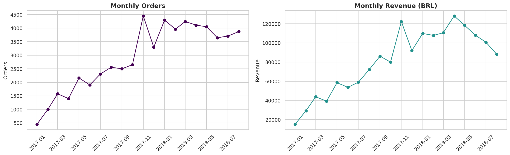
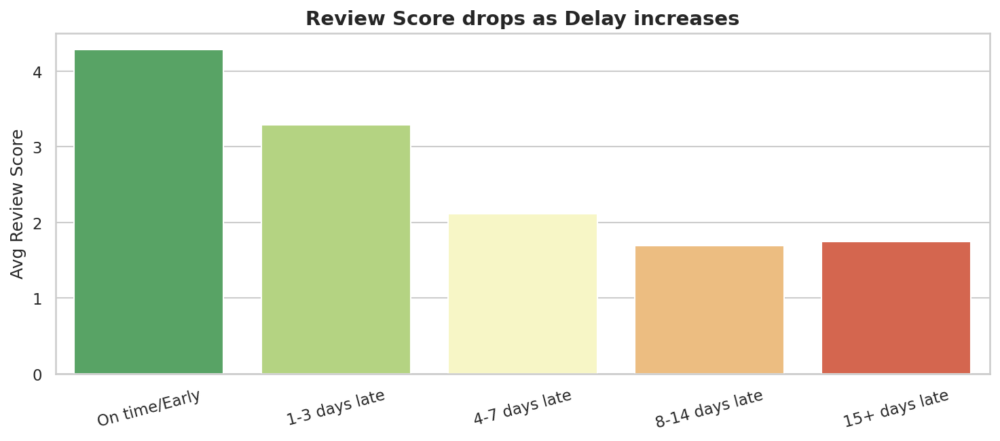
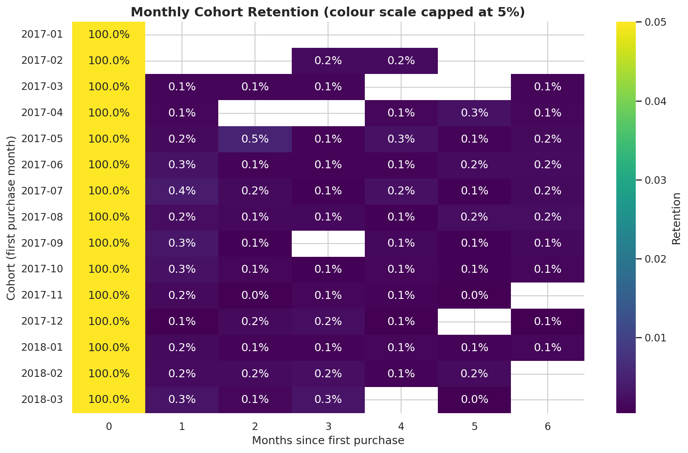

# 🛒 Olist Brazilian E-Commerce — End-to-End Data Analysis

End-to-end exploratory data analysis on the **Olist Brazilian E-Commerce dataset** (9 relational tables, ~100k orders, 2016–2018), covering sales trends, customer behaviour, delivery performance, seller analysis, RFM segmentation and cohort retention.

## 🎯 Business Questions
- How is the business performing (orders, revenue, AOV)?
- What are the monthly trends and seasonality?
- Which categories and states drive revenue?
- How do customers pay (type, installments)?
- How does delivery performance affect customer reviews?
- How concentrated is seller revenue?
- How loyal are customers (repeat rate, RFM, cohorts)?

## 📂 Dataset (9 files)
| File | Description |
|---|---|
| olist_orders_dataset.csv | Order status & timestamps |
| olist_order_items_dataset.csv | Items, price, freight, seller |
| olist_order_payments_dataset.csv | Payment type, installments, value |
| olist_order_reviews_dataset.csv | Review scores & comments |
| olist_customers_dataset.csv | Customer location & unique ID |
| olist_sellers_dataset.csv | Seller location |
| olist_products_dataset.csv | Product attributes |
| olist_geolocation_dataset.csv | Zip code → lat/lng |
| product_category_name_translation.csv | Portuguese → English categories |

Download: [Kaggle – Olist Brazilian E-Commerce](https://www.kaggle.com/datasets/olistbr/brazilian-ecommerce)

## 🛠️ Tech Stack
Python · Pandas · NumPy · Matplotlib · Seaborn · Google Colab

## 🔄 Project Workflow
1. Load & understand 9 tables
2. Data cleaning (dates, category translation, geolocation dedup)
3. Merge into order-level and item-level master tables
4. Feature engineering (delivery days, delay, late flag, time features)
5. EDA (KPIs, trends, categories, states, payments, delivery, reviews, sellers)
6. Customer analytics (repeat rate, RFM, cohort retention)
7. Insights & business recommendations

## 📊 Key Findings
> Replace these with your own numbers after running the notebook.
- Orders/revenue grew strongly through 2017–2018, peaking at Black Friday 2017
- Sales concentrated in SP, RJ, MG
- Credit card is the dominant payment method
- Late deliveries significantly reduce review scores
- Only ~3% customers are repeat buyers → major retention opportunity

## 🖼️ Sample Visuals





## 🚀 How to Run
1. Download the 9 CSVs from Kaggle and put them in a Google Drive folder `olist/`
2. Open `Olist_E2E_Data_Analysis.ipynb` in Google Colab
3. Set `DATA_DIR` in the setup cell to your Drive path
4. Run all cells

## 📁 Repo Structure
```
├── Olist_E2E_Data_Analysis.ipynb
├── images/            # saved charts
├── data/processed/    # cleaned master tables (optional)
├── requirements.txt
└── README.md
```

## 👤 Author
**Ayush** — [LinkedIn](#) · [GitHub](#)
